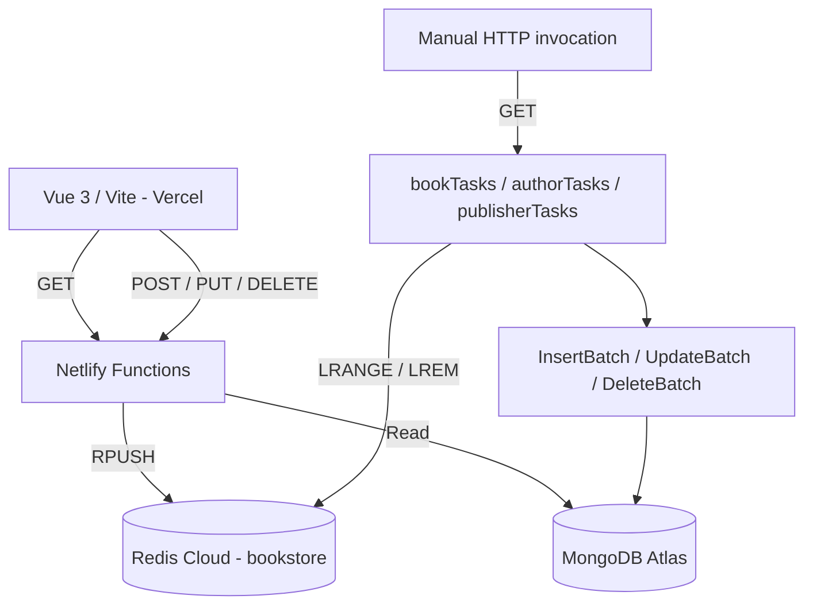

# Bookstore Redis

A distributed bookstore catalog built with Vue 3, Netlify Functions, Redis Cloud and MongoDB Atlas. Read operations query MongoDB directly, while write operations are queued in Redis and applied through entity-specific batch processors.

[](https://bookstore-redis-one.vercel.app/)
[](https://bookstore-redis.netlify.app/)


## Live application

| Component | URL |
| --- | --- |
| Frontend | [Bookstore](https://bookstore-redis-one.vercel.app/) |
| Backend | [Netlify API](https://bookstore-redis.netlify.app/) |

## Features

- Catalog management for books, authors and publishers (CRUD).
- Asynchronous writes through a shared Redis list named `bookstore`.
- Entity-specific task processors and batch operations.
- MongoDB Atlas persistence with numeric identifiers and existing catalog schemas.
- Independent frontend and serverless backend deployments.
- Responsive Spanish-language interface with a minimalist chocolate-and-cream theme.
- Manual task execution outside the catalog UI, following the course workflow.

## Architecture



Write endpoints return HTTP `202 Accepted` after Redis confirms the enqueue operation. The record is persisted only when its task processor runs successfully. Each processor filters the shared list by entity and removes successfully applied messages with `LREM`; failed operations remain pending. Batch inserts use an idempotent upsert by `_id`.

## API

Base URL: `https://bookstore-redis.netlify.app/.netlify/functions/`

| Method | Books | Authors | Publishers |
| --- | --- | --- | --- |
| GET | `bookFindAll` | `authorFindAll` | `publisherFindAll` |
| GET | `bookFind/:id` | `authorFind/:id` | `publisherFind/:id` |
| POST | `bookInsert` | `authorInsert` | `publisherInsert` |
| PUT | `bookUpdate/:id` | `authorUpdate/:id` | `publisherUpdate/:id` |
| DELETE | `bookDelete/:id` | `authorDelete/:id` | `publisherDelete/:id` |
| GET | `bookTasks` | `authorTasks` | `publisherTasks` |

Batch functions are invoked internally by task processors. Direct HTTP execution of Batch endpoints is rejected (`403 Forbidden`).

## Project structure

```text
bookstore-Redis/
├── frontend/
│   ├── src/
│   │   ├── components/
│   │   ├── lib/
│   │   └── router.js
│   ├── .env.example
│   ├── package.json
│   ├── vercel.json
│   └── vite.config.js
├── netlify/
│   ├── functions/
│   └── lib/
├── public/
├── .env.example
├── .gitignore
├── netlify.toml
├── package.json
├── README.md
├── README_Academico.md
└── GUIA_DESDE_CERO.md
```

## Local development

Prerequisites: Node.js 20+, npm, a MongoDB Atlas database, and a Redis Cloud database. Use a MongoDB application user with `readWrite` access to `bookstore` and authorize your development IP in Atlas.

```bash
git clone https://github.com/AndreaCarrilloOp/bookstore-Redis.git
cd bookstore-Redis
```

### Backend

From the repository root, create `.env` using `.env.example`. In PowerShell:

```powershell
Copy-Item .env.example .env
npm install
```

```dotenv
MONGODB_URI=YOUR_MONGODB_CONNECTION_STRING
MONGODB_DB=bookstore
REDIS_HOST=YOUR_REDIS_HOST
REDIS_PORT=YOUR_REDIS_PORT
REDIS_USERNAME=default
REDIS_PASSWORD=YOUR_REDIS_PASSWORD
REDIS_TLS=false
TASKS_BATCH_SIZE=20
TASKS_TOKEN=
```

Use `REDIS_TLS=false` for the non-TLS endpoint used in this project; enable TLS if required by your Redis instance. Keep credentials private.

```bash
npm run dev
```

Backend: `http://localhost:8888`.

### Frontend

In a second terminal, from the repository root:

```powershell
cd frontend
Copy-Item .env.example .env
npm install
npm run dev
```

The development client uses `/api` (also documented in `frontend/.env.example`). The Vite proxy forwards API requests to Netlify Dev at port `8888`. Open the local URL printed by Vite (normally `http://localhost:5173`).

## Deployment

| Setting | Netlify (backend) | Vercel (frontend) |
| --- | --- | --- |
| Base / Root directory | Repository root | `frontend` |
| Framework | No frontend build | Vite |
| Build command | None | `npm run build` |
| Publish / Output directory | `public` | `dist` |
| Functions directory | `netlify/functions` | — |
| Install command | Default | `npm ci --include=dev` (with committed lockfile) |

Configure database credentials and batch settings only in Netlify for deployment (and in the private root `.env` for local development). Set `VITE_API_BASE=https://bookstore-redis.netlify.app` in Vercel for the production build. Atlas network access must allow the backend's egress; prefer narrowly scoped access where available. If the frontend has no committed `package-lock.json`, use `npm install --include=dev` instead of `npm ci`, or generate and commit the lockfile first.

## Verification

From `frontend/`:

```bash
npm run build
```

To inspect pending messages, execute the following in Redis Insight or redis-cli before invoking the corresponding task endpoint manually:

```redis
LRANGE bookstore 0 -1
```

After submitting a write operation in the catalog, inspect the Redis list. Invoke the corresponding `GET` task endpoint manually (for example via a separate browser tab or PowerShell), then reload the catalog and check MongoDB Atlas. If the response reports `remaining: true` without errors, invoke the same processor again. If it reports errors or `busy`, investigate before retrying. `remaining` is entity-specific and does not prove the entire shared queue is empty. Do not invoke a task endpoint merely to check availability: it applies queued writes.

```powershell
# Local example: process only pending book operations
Invoke-RestMethod "http://localhost:8888/.netlify/functions/bookTasks"
```

In production, use the Netlify origin in place of `http://localhost:8888`. If `TASKS_TOKEN` is configured, send it privately in the `x-tasks-token` request header; never include it in frontend code. The JSON report includes `processed`, `remaining` and `errors`.


## Project scope

Academic distributed systems project. The application is a demonstration, not a production-hardened service: public CRUD endpoints do not implement full user authentication, Redis consumption is not a distributed transaction, and author/publisher embedded book references are not automatically synchronized by the batch operations. Do not use sensitive data or commit private `.env` files. An optional `TASKS_TOKEN` protects manual task invocations but must never be embedded in the public frontend.

## Credits

Academic project for EIF508 — Distributed Systems, Universidad Nacional (UNA), Costa Rica.
